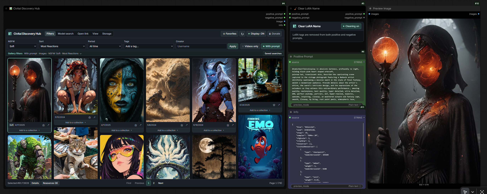
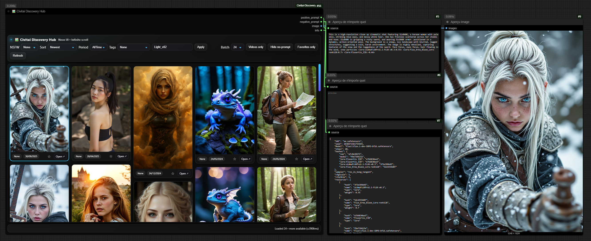
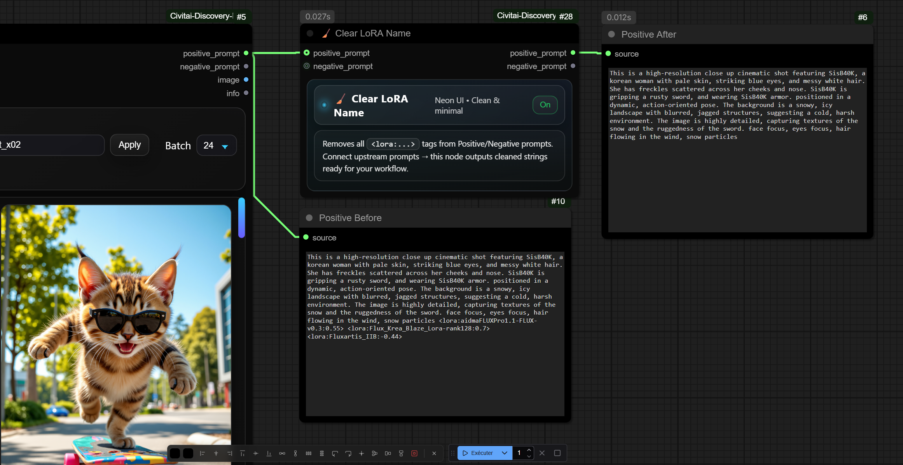

# 📜 ComfyUI-Civitai-Discovery-Hub

**Supported languages**  
:gb: English · :fr: Français · :es: Español · :cn: 简体中文 (Simplified Chinese) · :taiwan: 繁體中文 (Traditional Chinese) · :jp: 日本語 (Japanese) · :kr: 한국어 (Korean)

Both nodes follow the language selected in **ComfyUI Settings → Comfy → Locale → Language**.

⭐ **Give a star, it shines and keeps us motivated! ✨**

[☕ Support on Ko-fi](https://ko-fi.com/light_x02)


> Browse Civitai images and videos inside ComfyUI, save favorites, and send prompts, metadata and a still image to your workflow.

- **GitHub**: [https://github.com/Light-x02/ComfyUI-Civitai-Discovery-Hub](https://github.com/Light-x02/ComfyUI-Civitai-Discovery-Hub)
- **Node name in ComfyUI**: **Civitai Discovery Hub**



[Watch the overview video](https://www.youtube.com/watch?v=0z4scGXWCug)

## Changelog

### 1.7.0 (November 28, 2026) · Collections, image search and seven languages

- **Seven interface languages.** Civitai Discovery Hub and Clear LoRA Name now follow your ComfyUI language. Choose English, French, Spanish, Simplified Chinese, Traditional Chinese, Japanese or Korean in **Settings → Comfy → Locale → Language**.
- **Organize your favorites.** Open **Favorites → Collections** to create a collection and choose its cover. Use **Add to a collection** on any card to file an image or video in several collections. Highlighted names show where it belongs. Click a name again to remove it from that collection.
- **Find images by checkpoint or LoRA.** Narrow the results by base model or version, see how many models match as you type, and use creator suggestions to find a specific artist.
- **Combine tags in image searches.** Choose **Dragon** and **Landscape**, for example, to find images tagged with both. Remove either tag with **×** to broaden the search. View your active filters above the gallery and save a search to reuse it in another workflow.
- **Discover more images.** Browse the oldest or most collected images, or choose **Random** and click **Shuffle again** for another draw with the same filters.
- **Inspect and reuse a selection.** Open **Details** to enlarge an image, play a video, copy either prompt or read its generation settings. **Resources** lists the published model versions and LoRA weights. Paste a Civitai image or post URL in **Open link**, then return to your previous gallery page.
- **Manage storage and previews.** Choose your favorites folder under **Storage**. Switch **Display** off to unload previews, then back on to reopen the same page or draw. **Clear image cache** removes this node’s saved previews for the current browser profile. The preview cache is limited to 64 MiB per ComfyUI profile in this browser.

Tested with the classic ComfyUI canvas and Nodes 2.0. After updating, restart ComfyUI and reload the browser tab.

### 1.6.1 (November 27, 2026) · ComfyUI Nodes 2.0 compatibility

#### Nodes 2.0 and gallery navigation

- In Nodes 2.0, hover over the gallery and use the mouse wheel to browse images. No click is needed. Ctrl + wheel still zooms the workflow, and moving the pointer outside the gallery restores the normal mouse wheel behavior.
- The gallery scrolls within the node at every page size, including 150 items. The filters and page buttons stay in view. The internal `selection_data` field is hidden, and the selected item is still saved with the workflow.
- Cards now fill the shortest column across the entire page. Portraits and landscapes keep their proportions, with even spacing when the node is resized or the thumbnail size changes.
- The gallery now loads and unloads previews one card at a time near the visible area. Each card keeps its place as you scroll, and the selected card is highlighted when you return to it.

#### Image output

- Fixed an execution error when the `IMAGE` output was connected to **Preview Image** or another image node. The Hub now accepts original media and HTTPS redirects from `image-b2.civitai.com` and `blobs-b2.civitai.com`. If another host is rejected, the error message names it.

#### Clear LoRA Name

- The cleaner now shares the gallery's visual style. The **Cleaning on** and **Cleaning off** states explain whether LoRA tags are removed from both prompts or passed through.
- With Nodes 2.0 turned off, the panel follows the width of the classic node. The button stays inside the frame and the description wraps when the node is narrow.

After updating, restart ComfyUI and reload the browser tab (Ctrl + F5 on Windows).

<details>
<summary>1.6.0 (November 26, 2026) &middot; Gallery redesign and pagination</summary>

#### Redesigned gallery interface

- A compact toolbar separates **Filters**, **Model search** and **View** into tabs. **Favorites**, **Refresh**, **Clear previews** and **Display** stay within reach on every tab. The controls reflow when the node is narrower.
- A teal outline marks the selected card. The footer keeps the selected item ID, page buttons and loading status together below the grid.

#### Gallery and navigation

- The gallery now opens in pages of 24, 50, 100 or 150 items. Use the first, previous, numbered and next buttons below the cards to move between pages. Changing the search filters starts a new result set on page 1.
- Switching workflow tabs or reopening a saved workflow restores the active page, filters, control panel and node dimensions. Each gallery keeps its own settings and selection.
- Search for a checkpoint or LoRA by name, then choose a result to see its online gallery. The clear button cancels a pending search and removes the model filter.
- Fixed empty results with **With prompt**. The gallery requests public generation metadata, recognizes more positive-prompt formats and follows continuation pages when a batch contains only items without a positive prompt.

#### Preview quality and memory

- Four thumbnail sizes control the card layout. A separate resolution setting requests 256, 512 (default), 768 or 1024 px previews, or the original URL. Signed and non-resizable URLs are kept intact. Preview quality only applies to browsing.
- Gallery media loads near the visible area. **Clear previews** cancels pending gallery loads, unloads images and videos, releases cached page data and turns **Display** off. Turn it back on to reopen the same page. This keeps the selected workflow item and saved favorites.
- The image output downloads the selected original only when connected and produces an RGB image or the first frame of a video. Media decoding uses less temporary memory and enforces limits of 64 MiB per image, 128 MiB per video and 32 megapixels per decoded frame.

#### Favorites and workflows

- Each ComfyUI profile now keeps its favorites in SQLite. Date-sorted pages use an index, and favorite changes are committed transactionally. A failed save is reported in the gallery.
- On the first run in single-user mode, the Hub imports the old `civitai_favorites.json` and keeps the source file. Multi-user installations give each profile its own collection.
- **Clear LoRA Name** handles consecutive tags and mixed-case spellings, keeps prompt line breaks and passes both prompts through when disabled. The workflow guide shows how to connect the prompt, image and JSON outputs.
- The two nodes are registered explicitly. GitHub runs the Python and JavaScript regression suites before publishing. The Registry package excludes test files and GitHub workflow configuration.

After updating, restart ComfyUI and reload the browser tab to load the new interface.

</details>

<details>
<summary>1.5.0 (December 16, 2025) &middot; V3 migration and gallery stability</summary>

#### ✅ V3 Migration (code fully rewritten)
- Migrated the **🖼️ Civitai Discovery Hub** node to **V3**.
- For this migration, **all code was rewritten** (Python + JavaScript) to be cleaner, V3-compatible, and more robust.

#### 🔧 Universal Loader (V3)
- Introduced automatic discovery of Python modules.

#### 🚀 Stability & Performance
- Fixed a bug where the gallery could shift / “move by itself”: if you scrolled down, then panned the workflow view and came back to the node, the list would unexpectedly re-align.
- Fixed a related issue: when returning to the node after moving around the workflow, it could **append already-loaded images again**, which could eventually slow down ComfyUI.

✅ The gallery now stays **exactly** at the same position as long as you don’t scroll, and it no longer duplicates content when you move around the workflow.



</details>

---

## ✨ Main Features

- Browse Civitai images and videos by checkpoint, LoRA, model version, creator or a combination of tags. Narrow the results to videos or media with a published prompt.
- Page through the results or shuffle a new selection. The workflow remembers your page or draw, filters and selection.
- Organize favorites into local collections with custom covers, and reuse saved searches across workflows.
- Inspect a selection’s prompts, generation settings and resources. Open a Civitai image or post directly from its URL.
- Send positive and negative prompts, JSON metadata and an RGB image to your workflow. Selecting a video provides its first frame.

---

## 🧩 Installation

### Method 1: Install via ComfyUI Manager

1. Open **Custom Nodes** in ComfyUI Manager.
2. Search for **ComfyUI-Civitai-Discovery-Hub** and install the package.
3. Restart ComfyUI and reload the browser tab.

### Method 2: Clone the repository

1. Open a terminal in your ComfyUI `custom_nodes` directory.
2. Clone the extension.

   ```bash
   git clone https://github.com/Light-x02/ComfyUI-Civitai-Discovery-Hub.git
   ```

3. Restart ComfyUI and reload the browser tab. The pack registers **Civitai Discovery Hub** and **Clear LoRA Name**.

---

## 🚀 Usage in a workflow

Add **Civitai Discovery Hub**, select a card, then connect the outputs you need.

| Output | Type | Example connection |
| --- | --- | --- |
| `positive_prompt` | STRING | **Clear LoRA Name** → **CLIP Text Encode** (positive conditioning) |
| `negative_prompt` | STRING | A second **CLIP Text Encode** (negative conditioning) |
| `image` | IMAGE | **Preview Image** for the photo or the first frame of a video |
| `info` | STRING | A text viewer for the remaining generation metadata as formatted JSON |

To connect a string to **CLIP Text Encode**, convert its text widget to an input if your frontend displays it as a text field. Queue the workflow to execute the connected branch.

The workflow downloads the selected media when the **Image** output is connected. Image and video downloads are restricted to approved Civitai hosts. The limits are 64 MiB per image, 128 MiB per video, and 32 megapixels per decoded frame. Browsing the gallery also loads thumbnails in the browser.

Single-user installations save `favorites.sqlite3` in **Documents/Comfyui Light_x02/Civitai Discovery Hub**, using the operating system's Documents location. The database holds Civitai media references and metadata. On first use the Hub copies existing profile favorites and keeps the original. Older JSON collections are imported as well.

Open **Storage** on localhost to browse folders on the ComfyUI computer or enter a new folder path. **Save folder** creates the directory if necessary and moves your favorites, collections and saved searches together. **Use default** selects Documents again, then **Save folder** confirms the move. The setting applies across workflows. In multi-user mode each profile keeps its own private database under `civitai-discovery-hub/favorites.sqlite3`.

In **Favorites only**, the period uses the media's publication date, and reaction and comment counts reflect the last saved item. The tag filter uses Civitai tag IDs saved with the item. Older favorites can lack these IDs.

---

## 🖱️ Interface & Controls

### Control bar

- **Filters** includes content rating, sort, period, tags and creator. Choose tags one at a time. Each result must match all selected tags. Click a tag's × to remove it. Creator suggestions appear after two characters. Apply the name with **Apply** or Enter.
- Choose **Random**, then **Shuffle again** for another draw. If Civitai rejects random sorting for a filter, the Hub samples the filtered feed and labels the result. **Most Collected** is available in the online gallery. When browsing by a specific model, choose a version for Civitai's engagement rankings.
- In **Model search**, choose **Checkpoints** or **LoRAs** under **Model type** to browse up to 30 matches. Typing a name updates **Model filter** after a short pause. Enter or **Find model** searches immediately. The count and search criteria appear below the list. When Civitai only supplies a continuation, the count describes the models shown. **All types** groups the results by type. Choose a model to see its images.
- **Gallery filters** stays above the images on every tab. Expand it for details about the current results. Selected tags appear as removable chips in **Filters**.
- Under **Filters**, open **Saved searches** to name the current combination. Choose a saved search and click **Apply** to use it in another workflow, or **Update** to replace its filters.
- In **Favorites**, click the first tile, **Collections**, to open the collection browser. It is available even when your favorites are empty. Inside, the **+** tile creates a collection. Click a named cover to browse it. The path above the images lets you return to **Collections** or directly to **All favorites**.
- **Base model** narrows the search to a model family. **Version** selects a specific release of the chosen model. The × next to the search field clears the selected model and version. Base-model filtering also works for favorites saved with a base model.
- **Open link** accepts a Civitai image or post URL. It uses the current content rating and can show both images and videos. **Back to gallery** returns to where you were browsing.
- **View** controls thumbnail size, preview resolution and items per page (24, 50, 100 or 150). Preview resolution applies to resizable CDN images. The workflow uses the original media.
- Turn **Display** off to cancel pending gallery requests and unload its images, videos and page data. Turn it on to reload the same page. The workflow selection and saved favorites are preserved.
- **Storage → Clear image cache** clears the Hub’s preview cache on this browser. Images already visible stay on screen. The node starts saving new previews again when you leave the Storage tab. Persistent preview storage requires localhost or HTTPS and browser storage access. Older HTTP cache entries and video playback use the browser’s own cache controls.
- **Favorites**, **Refresh** and **Display** remain accessible from every panel. The workflow saves each node's panel, filters and page. The coffee button opens the author's Ko-fi page in a new tab.

The gallery uses the public Civitai API without an account. Civitai applies its browsing limits to these requests.

### Grid & Cards

- **★ Favorite**: toggle favorite with one click
- **Add to a collection** lists your local collections. A highlighted name and check mark indicate membership. Click the name again to remove the item from that collection. Filing an item also saves it to Favorites. Removing it from a collection keeps its star.
- **Cover** selects a still image from that collection for its tile. When a cover is removed or exceeds the current content rating, the tile shows another eligible image if one is available. Deleting a collection keeps its favorites.
- **Open link (↗)**: open the Civitai page in the browser

### Selection

Click a card to use it in the workflow. Its prompts and metadata come from the selected Civitai post. A post can have an empty negative prompt or omit generation metadata entirely.

Open **Details** next to the selected ID to read and copy prompts. The arrows change the workflow selection as you browse. **Enlarge** opens the published image at full size and **Esc** returns to the gallery.

Click **Resources** beside the selection to see its published checkpoints and LoRAs. Version links open on Civitai, and weights are shown when supplied. Names missing from the image metadata are looked up only while the panel is open.
---

## 💡 Performance Tips

- **Per page** controls the number of cards per page. Use 24 on a slow connection and increase it when browsing many results.
- **Display** pauses gallery rendering while you work elsewhere in the graph.
- **With prompt**: useful to focus on workflow-ready content.
- **Favorites**: use **Favorites only** mode to build reusable libraries.

---

# 🧹 Clear LoRA Name — Utility Node for ComfyUI

The **Clear LoRA Name** node is a lightweight utility designed to work seamlessly with the **Civitai Discovery Hub** extension. Its purpose is to **clean prompts** by automatically removing any embedded **LoRA tags** of the form `<lora:Some_LoRA_Name:0.7>` or similar variations.



## 🔧 How it works
- **Inputs**:  
  - `positive_prompt` (optional)  
  - `negative_prompt` (optional)  
- **Process**:  
  - The node parses both prompts.  
  - All `<lora:...>` tags are stripped out.  
  - The remaining text is cleaned to remove extra spaces or artifacts.  
- **Outputs**:  
  - `positive_prompt` (cleaned)  
  - `negative_prompt` (cleaned)  

## 🚀 Why it’s useful with Civitai Discovery Hub
When browsing images in **Civitai Discovery Hub**, many prompts include references to LoRAs that might **not be available locally**. Using these raw prompts in your workflow can trigger errors or produce unexpected results.  
By placing the **Clear LoRA Name** node after the Hub’s prompt outputs:
- You keep the descriptive part of the prompt intact.  
- You remove external dependencies (`<lora:...>`).  
- Your workflow becomes **portable, clean, and reproducible**.  

## 🖥️ UI Features 
- **On/Off toggle**: quickly enable/disable the cleaning process without deleting the node.  
- **Compact and minimal**: fits smoothly into your workflow as a utility step.  

## ✅ Example
**Original prompt from Civitai Discovery Hub**:  
`A cinematic portrait of a warrior <lora:FluxHeroXL:0.8> in a snowy landscape`

**After Clear LoRA Name**:  
`A cinematic portrait of a warrior in a snowy landscape`


---
## ❓ FAQ

**Q. The gallery stopped loading. How do I continue?**  
Check the status below the gallery. If the network request failed, use **Retry** to resume. Use **Refresh** to restart from the first page.

**Q. Favorites don’t appear immediately in “Favorites only” mode.**\
The list is refreshed automatically, but if there is still a delay, use **Refresh** to sync.

**Q. Can I use a video from the gallery as a moving clip in my workflow?**  
The gallery plays video previews. The **Image** socket supplies the first decoded frame as a single RGB image. The prompt and JSON outputs are available independently.

---

## 🔗 Useful Links

- **Repo GitHub** : [ComfyUI-Civitai-Discovery-Hub](https://github.com/Light-x02/ComfyUI-Civitai-Discovery-Hub)
- **Ko-fi** : [https://ko-fi.com/light\_x02](https://ko-fi.com/light_x02)

---

## 🙏 Acknowledgements

Thanks to the ComfyUI community for feedback and suggestions.\
A coffee always helps inspire new [features](https://ko-fi.com/light_x02)[ 👉 ](https://ko-fi.com/light_x02)[Ko-fi](https://ko-fi.com/light_x02).

